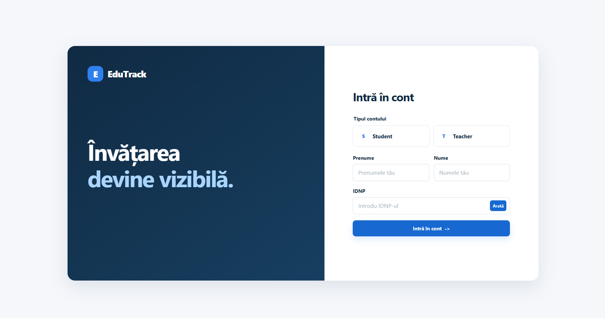

# EduTrack

EduTrack - интерактивный frontend-прототип учебной платформы для управления курсами, заданиями, ответами и прогрессом студентов.
> **Ссылка на сайт:** [Открыть EduTrack](https://chernichka03.github.io/-EduTrack/)
 
> 
Проект подготовлен для демонстрации практической части Teza de an. Текущая версия реализована только на HTML, CSS и JavaScript. Серверная часть, PHP, MySQL и регистрация пользователей пока не используются.

## Возможности

- вход по выбранной роли Student или Teacher;
- проверка имени, фамилии и учебного кода IDNP;
- отдельная панель для каждого студента;
- панель преподавателя со списком курсов, ответов и прогрессом студентов;
- два готовых курса и четыре задания для демонстрации;
- просмотр описания задания, срока и текущего состояния ответа;
- отправка нового ответа и изменение уже отправленного ответа;
- выставление целой оценки от 1 до 10;
- добавление комментария преподавателя;
- отображение статусов «Verificat» и «În așteptare»;
- расчёт прогресса и среднего балла;
- сохранение изменений в localStorage;
- адаптация интерфейса для компьютера, планшета и телефона.

Список аккаунтов не отображается на странице входа. Данные для демонстрации приведены ниже, чтобы преподаватель мог проверить готовый прототип.

## Запуск проекта

### Вариант 1. Локальный статический сервер

Рекомендуемый способ запуска:

```bash
python3 -m http.server 8000
```

После запуска откройте в браузере:

```text
http://localhost:8000
```

Команду нужно выполнить из папки, в которой находится файл `index.html`.

В Windows вместо `python3` можно использовать:

```bash
py -m http.server 8000
```

### Вариант 2. Открытие файла

Можно открыть `index.html` двойным нажатием. Для более стабильной работы localStorage и одинакового адреса демонстрации лучше использовать локальный статический сервер.

## Учебные аккаунты

Используемые IDNP являются вымышленными учебными кодами и не относятся к реальным персональным данным.

| Роль | Имя и фамилия | Учебный код IDNP |
|---|---|---|
| Teacher | Ana Popescu | `1000000000001` |
| Student | Ion Rusu | `1000000000002` |
| Student | Alex Popa | `1000000000003` |
| Student | Maria Ceban | `1000000000004` |

Для входа необходимо заполнить все поля и выбрать правильную роль. Если роль не выбрана или не соответствует аккаунту, вход запрещается.

## Сценарий демонстрации

1. Откройте приложение и выберите роль `Student`.
2. Введите данные `Ion Rusu` и код `1000000000002`.
3. Откройте курс, просмотрите задание и измените текст ответа.
4. Нажмите кнопку отправки и проверьте, что ответ получил статус ожидания проверки.
5. Выйдите из аккаунта и войдите как `Teacher` с данными `Ana Popescu` и кодом `1000000000001`.
6. Откройте курс через кнопку `Gestionează`.
7. Выберите оценку от 1 до 10, добавьте комментарий и сохраните результат.
8. Снова войдите как соответствующий студент и проверьте обновлённую оценку и комментарий.
9. Обновите страницу, чтобы проверить сохранение данных после перезагрузки.

## Структура проекта

| Файл | Назначение |
|---|---|
| `index.html` | HTML-структура страницы и форма входа |
| `styles.css` | Визуальное оформление, сетки, цвета и адаптация интерфейса |
| `app.js` | Учебные данные, вход, навигация, обработчики и расчёты |
| `favicon.svg` | Значок страницы браузера |
| `README.md` | Описание проекта и инструкция по демонстрации |

## Как работает приложение

Приложение загружает подготовленные данные о пользователях, курсах, заданиях и ответах из `app.js`. После входа JavaScript определяет роль пользователя и формирует соответствующую панель.

Основные правила текущей версии:

- имена сравниваются без учёта регистра и внешних пробелов;
- роль должна быть выбрана явно;
- оценка может быть только целым числом от 1 до 10;
- отсутствие оценки хранится как `null` и не учитывается в среднем балле;
- прогресс показывает долю заданий, по которым существует отправленный ответ;
- повторная отправка ответа сбрасывает старую оценку и комментарий, потому что проверяется уже новая версия работы;
- введённый текст экранируется перед выводом в HTML.

Данные учебной части сохраняются в браузере с помощью следующих ключей:

- `edutrack-teza-frontend-data-v1` - курсы и ответы;
- `edutrack-teza-frontend-session-v1` - идентификатор текущего аккаунта.

При обновлении структуры данных старые оценки из шкалы 0-100 один раз переводятся в шкалу 1-10. Ответы, комментарии и непроверенные работы при этом сохраняются.

## Ограничения демонстрационной версии

- данные хранятся только в localStorage текущего браузера;
- изменения не синхронизируются между разными компьютерами и браузерами;
- вход является демонстрационной проверкой, а не защищённой авторизацией;
- учебные коды доступны в JavaScript и не должны использоваться как настоящие пароли;
- регистрации пользователей нет;
- ответы поддерживают только текст без загрузки файлов;
- сроки заданий пока информационные и не блокируют позднюю отправку;
- история версий ответов, уведомления и экспорт результатов пока не реализованы;
- кнопки создания новых курсов, заданий и экспорта показывают направление дальнейшего развития, но пока не создают записи и не скачивают отчёты.

## Дальнейшее развитие

Для следующей серверной версии, которая может быть использована в дипломной работе, планируется:

- подключение PHP и MySQL;
- настоящая регистрация и авторизация с защищёнными паролями;
- серверные сессии и проверка прав доступа;
- зачисление студентов на отдельные курсы;
- загрузка файлов и история изменений ответов;
- уведомления о сроках и новых проверках;
- создание курсов и заданий преподавателем;
- экспорт оценок и прогресса.

## Назначение проекта

EduTrack предназначен для учебной демонстрации и описания принципов создания интерактивного веб-приложения. В проекте не используются реальные персональные данные.
